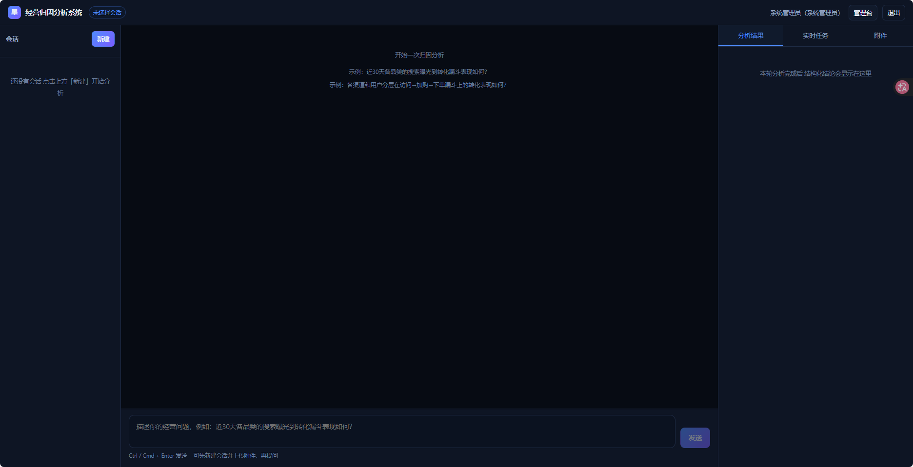
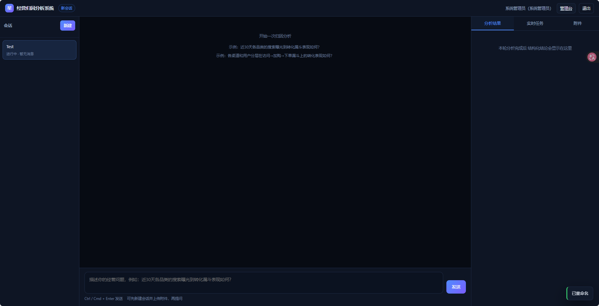
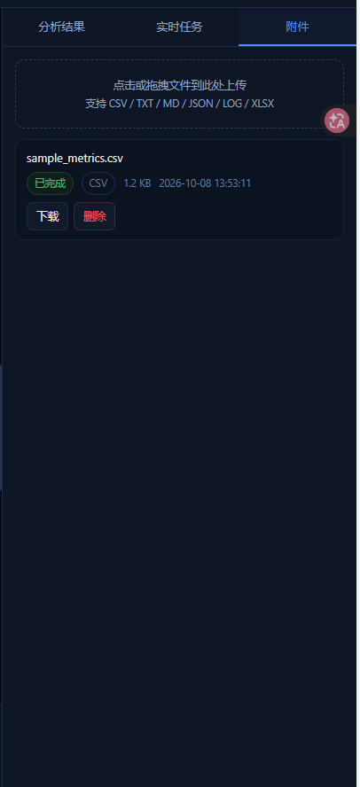
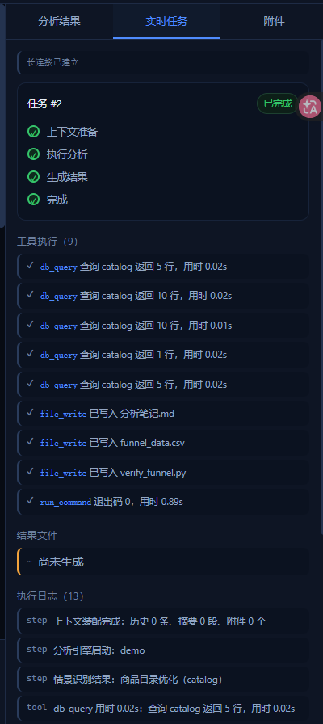
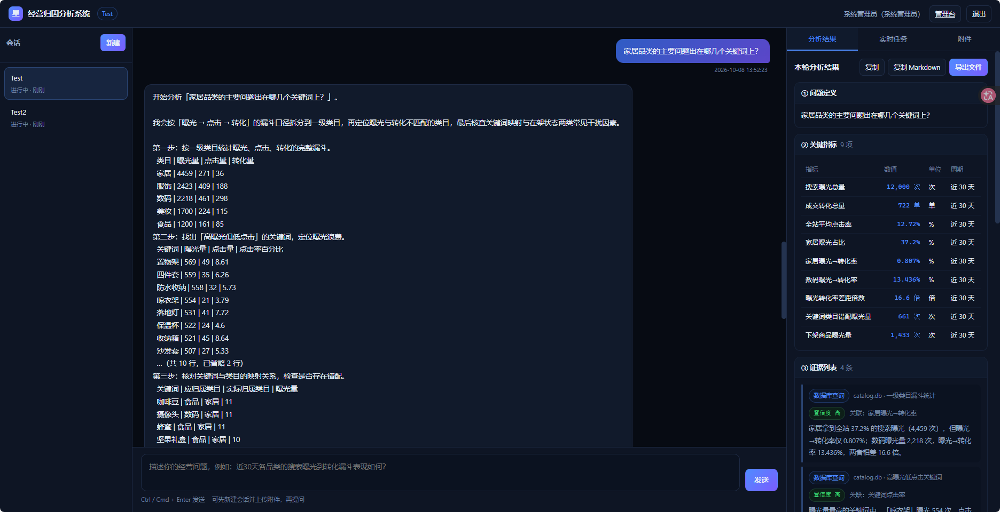
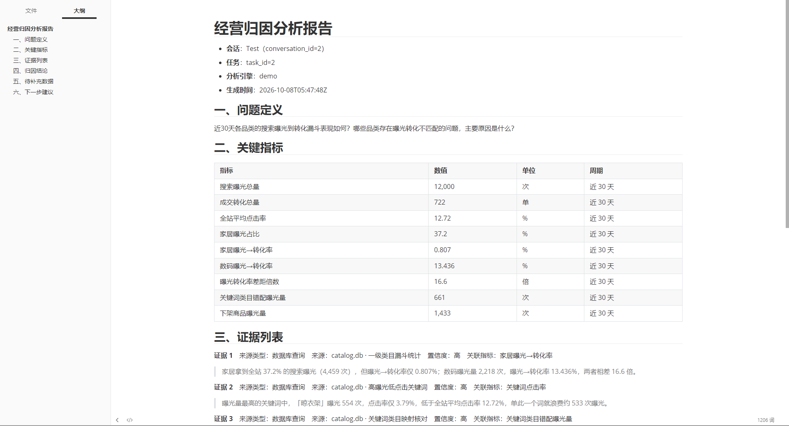
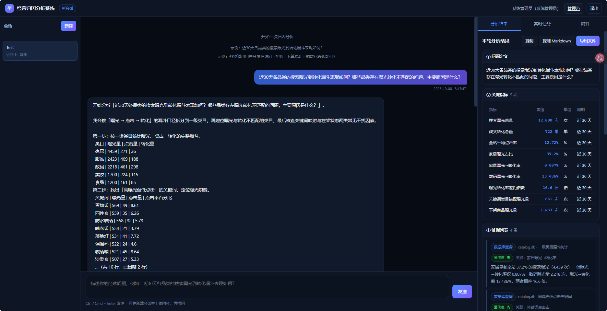
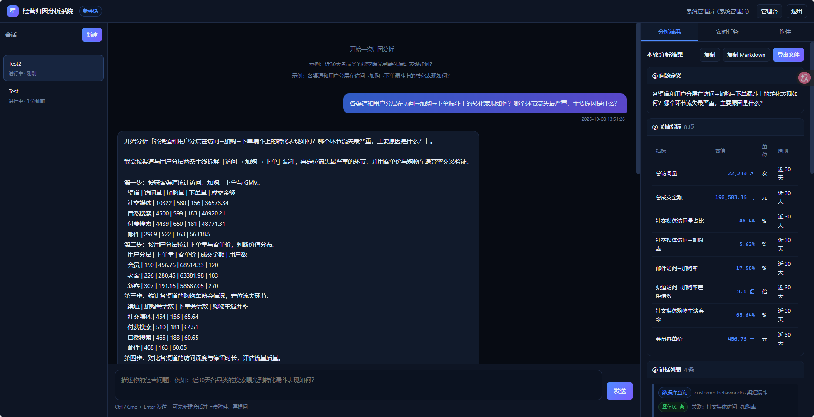
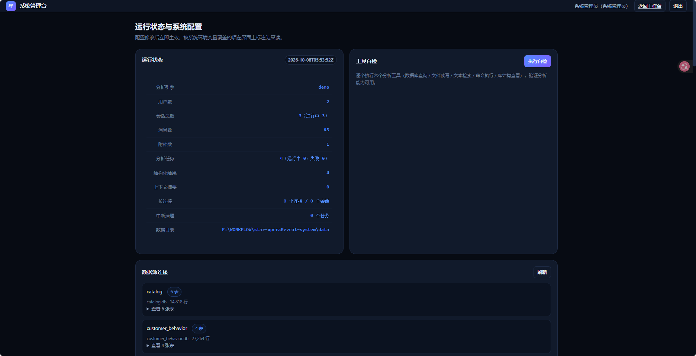

# 经营归因分析系统

面向经营分析场景的**多轮归因分析工作台**：围绕一个业务问题持续追问，系统自动查询数据、
检索资料、执行分析工具，通过长连接实时输出分析过程，并给出可追溯的六段式归因结论与导出报告。

```
问题 → 实时分析（工具执行可见）→ 六段式结论 → 导出 Markdown 报告 → 继续追问
```

---

## 界面预览

### 分析工作台

| 界面 | 截图 |
| --- | --- |
| 系统主页 |  |
| 新建会话 |  |
| 附件上传 |  |
| 实时任务 |  |
| 追问过程 |  |
| 导出 Markdown 报告 |  |

### 演示场景与管理台

| 界面 | 截图 |
| --- | --- |
| 演示一：商品目录优化 |  |
| 演示二：客户行为分析 |  |
| 管理台 |  |

---

## 快速开始

### 1. 安装依赖

项目使用 Python 3.12。仓库内已包含 `.venv`（**注意：该虚拟环境没有 pip**），
统一用 `uv` 通过清华镜像安装（`pypi.org` 在演示环境不可达）：

```bash
uv pip install --python .venv/Scripts/python.exe \
  --index-url https://pypi.tuna.tsinghua.edu.cn/simple \
  fastapi "uvicorn[standard]" aiosqlite httpx python-multipart openpyxl websockets python-dotenv
```

依赖清单以 `pyproject.toml` 为准。若需要浏览器端到端测试，额外安装：

```bash
uv pip install --python .venv/Scripts/python.exe \
  --index-url https://pypi.tuna.tsinghua.edu.cn/simple playwright
```

### 2. 启动服务

```bash
python run.py
```

**一条命令即可** —— 首次运行会自动完成初始化：

- 系统库 `data/system.db`：建表（10 张规格表）+ 写入 31 项默认配置（由后端启动时执行）
- 情景演示库 `db/demo/*.db`：6 个业务库、约 6.4 万行示例数据（由启动器生成，仅首次）

停止服务按 `Ctrl+C`。若只想重新初始化数据，可手动执行：

```bash
python scripts/init_db.py     # 幂等：重建系统表、补齐默认配置、重新生成情景库
```

单进程同时拉起两个服务：

| 服务 | 地址 | 说明 |
| --- | --- | --- |
| 分析后端 | <http://localhost:8000> | REST + WebSocket + 前端静态资源 |
| 认证中心 | <http://localhost:8001> | 模拟 OAuth2 授权服务 |

默认监听回环地址，且**同时绑定 IPv4 与 IPv6 回环**（`127.0.0.1` 与 `::1`），
因此 `http://localhost:8000` 与 `http://127.0.0.1:8000` 都能访问 ——
浏览器按 RFC 6724 会优先把 `localhost` 解析成 `::1`，若只绑定 IPv4 就会出现「拒绝连接」。

不对外暴露，也不会触发 Windows 防火墙提示。若需局域网访问：

```bash
python run.py --host 0.0.0.0
# 同时把 PUBLIC_BASE_URL 改为 http://<本机IP>:8000，
# 并在认证中心的白名单中加入 http://<本机IP>:8000/auth/callback
```

端口可通过 `BACKEND_PORT` / `AUTH_PORT` 环境变量或 `.env` 调整。停止服务按 `Ctrl+C`。

### 3. 打开浏览器

访问 <http://localhost:8000> → 点击「前往认证中心登录」→ 选择演示身份：

| 账号 | 角色 | 权限 |
| --- | --- | --- |
| `analyst` | 分析用户 | 会话、附件、提问、查看与导出结果 |
| `admin` | 系统管理员 | 上述全部 + 配置热更新、运行日志、数据源、工具自检 |

登录后在**新会话**中输入（可直接复制）：

```
近30天各品类的搜索曝光到转化漏斗表现如何？哪些品类存在曝光转化不匹配的问题，主要原因是什么？
```

即可看到完整的实时分析与六段式结论。完整演示说明见
[演示一：商品目录优化](docs/DEMO-01-catalog.md) 与
[演示二：客户行为分析](docs/DEMO-02-customer-behavior.md)。

---

## 功能

### 分析用户

- 授权登录、会话新建 / 重命名 / 标签归档 / 删除 / 切换
- 附件上传（拖拽或点击，带进度与解析状态）、下载、删除
- 提问后通过长连接实时看到：当前步骤、工具执行过程、增量结论、结果文件生成状态
- 六段式结构化结果：问题定义 / 关键指标 / 证据列表 / 归因结论 / 待补充数据 / 下一步建议
- 结果复制、Markdown 复制、导出报告文件并随时重新下载
- 历史消息回放、旧会话继续追问、随时取消正在执行的分析

### 系统管理员

- 系统配置查看与修改，**热更新即时生效**，无需重启
- 被环境变量覆盖的配置项自动标注为只读，避免「改了却没反应」
- 运行日志查看（按级别、按任务过滤）
- 数据源连接管理（查看 6 个情景库的表结构与行数）
- 六个分析工具的**一键自检**
- 运行状态概览（任务、结果、长连接、存储占用）

### 分析能力

| 能力 | 实现 | 在演示中的体现 |
| --- | --- | --- |
| 实时分析 | WebSocket 长连接推送 8 类消息 | 全程可见步骤与工具调用 |
| 数据库查询 | `db_query`，只读单条 SQL | 两个演示场景的核心取数 |
| 文件读写 | `file_read` / `file_write` | 写入 `分析笔记.md`、读取用户附件 |
| 文本检索 | `text_search` | 在附件中检索关键线索 |
| 命令执行 | `run_command`（白名单） | 执行独立校验脚本验证中间产物 |
| 结果文件生成 | Markdown 报告落盘 | 导出 `归因分析_report_*.md` |

---

## 分析引擎

系统内置三种引擎，可在管理台一键切换（`analysis.engine_mode`）：

| 模式 | 说明 | 是否需要 API Key |
| --- | --- | --- |
| `demo` | **默认**。规则化演示引擎：情景识别 + 固定 SQL 序列 + 据实计算 | 不需要 |
| `llm` | 大模型 Agent 引擎：模型自主决定取数与工具调用路径 | 需要 |
| `canned` | 固定输出的自检引擎，用于验证链路通畅 | 不需要 |

三种引擎共用同一套上下文装配、工具执行、结果落库、文件导出与实时推送链路，
因此界面上看到的步骤、工具调用与结果结构完全一致。

### 启用 LLM 引擎

复制 `.env.example` 为 `.env` 并填写：

```ini
ANTHROPIC_BASE_URL=https://api.deepseek.com/anthropic
ANTHROPIC_AUTH_TOKEN=你的密钥
ANTHROPIC_MODEL=deepseek-v4-pro
```

然后在管理台把「分析引擎」切换为 `llm`（或直接 `POST /api/admin/reload` 前先改配置）。
未配置密钥时 LLM 任务会**干净地失败**并给出明确提示，不会影响 demo 模式。

---

## 目录结构

```
├── run.py                      单进程启动器（后端 8000 + 认证中心 8001）
├── pyproject.toml  .env.example  .gitignore
├── backend/                    分析后端
│   ├── main.py                 应用装配、生命周期、静态资源
│   ├── config.py  database.py  session_auth.py  storage.py  utils.py
│   ├── conversations.py        会话共享逻辑（归属校验、序号、级联删除）
│   ├── routers/                认证 / 会话 / 附件 / 任务 / 结果 / 管理
│   ├── ws/                     长连接管理器与端点
│   ├── tasks/                  任务状态机、服务、运行器
│   ├── analysis/               引擎抽象、上下文、工具、结果构建
│   └── attachments/            附件解析
├── auth_service/               模拟 OAuth2 认证中心
├── frontend/                   零构建前端（原生 ES Module）
│   ├── index.html  callback.html  app.html  admin.html
│   ├── css/app.css
│   └── js/                     api / auth / session / chat / attachment / result / config / logs / ws / components
├── db/
│   ├── init.sql                10 张规格表 DDL
│   ├── seed_system.py          默认配置播种
│   ├── seed_scenarios.py       6 个情景库（确定性生成）
│   └── demo/                   生成的情景库
├── scripts/
│   ├── init_db.py              手动初始化 / 重建数据（幂等）
│   ├── smoke_test.py           端到端验收（92 项断言）
│   ├── ui_test.py              浏览器端到端测试（需 playwright）
│   └── fixtures/               测试样例文件
├── docs/
│   ├── API.md                  接口说明（REST + WebSocket）
│   ├── ARCHITECTURE.md         架构说明
│   ├── DEMO-01-catalog.md      演示一：商品目录优化
│   └── DEMO-02-customer-behavior.md  演示二：客户行为分析
└── data/                       运行时数据（数据库、上传、导出、工作区、密钥）
```

---

## 示例数据

`db/demo/` 下 6 个业务库，覆盖规格书要求的全部场景：

| 库 | 场景 | 数据 |
| --- | --- | --- |
| `catalog.db` | 商品目录优化 ⭐ | 类目 30 / 关键词 40 / 商品 500 / 曝光 12,000 / 点击 1,526 / 转化 722 |
| `customer_behavior.db` | 客户行为分析 ⭐ | 用户 2,000 / 访问 22,230 / 加购 2,351 / 下单 683 |
| `inventory.db` | 库存异常分析 | 商品 300 / 仓库 4 / 库存 1,200 / 入库 2,958 / 出库 4,818 / 销量 3,539 |
| `reviews.db` | 评论反馈分析 | 商品 200 / 评论 1,500 / 评分 200 / 退款 400 |
| `market.db` | 市场表现分析 | 渠道 4 / 区域 5 / 投放 40 / 订单 3,000 / 汇总 75 |
| `refunds.db` | 退款模式分析 | 用户 800 / 商品 250 / 订单 1,800 / 退款原因 7 / 退款申请 726 |

⭐ = 已完成全链路演示的两个场景。数据由固定随机种子生成，可重复构建且结果完全一致。

---

## 测试与验收

```bash
# 端到端验收（REST + WebSocket，92 项断言）
python scripts/smoke_test.py                 # 假定服务已启动
python scripts/smoke_test.py --start-server  # 自动拉起并关闭服务

# 浏览器端到端测试（需 playwright：uv pip install playwright）
python scripts/ui_test.py
```

验收覆盖：授权登录 → 会话 CRUD → 附件上传/解析/下载/删除与越界校验 → 长连接鉴权（一次性令牌、
越权、伪造）→ 分析任务全生命周期（8 类实时消息、六段式结果、导出下载）→ 单会话单任务 →
取消 → 历史序号与配对不变式 → 管理接口权限与配置热更新 → 级联删除 → 前端页面与静态资源。

---

## 配置

配置优先级：**进程环境变量 > `system_configs` 表 > `.env` 文件 > 内置默认值**。
某一层取到空值视为「该层未设置」，继续向下层回退。

常用配置项（完整 31 项可在管理台查看）：

| 配置键 | 默认值 | 说明 |
| --- | --- | --- |
| `analysis.engine_mode` | `demo` | 分析引擎：`demo` / `llm` / `canned` |
| `analysis.max_concurrent_tasks` | `2` | 全局同时运行的分析任务数 |
| `analysis.tools_enabled` | 六个工具全开 | 逗号分隔；去掉某项即停用该工具 |
| `analysis.summarize_after_messages` | `12` | 触发上下文压缩的消息条数阈值 |
| `analysis.scenario_db_dir` | `db/demo` | `db_query` 唯一可访问的数据库目录 |
| `upload.max_file_size_mb` | `20` | 附件大小上限 |
| `upload.allowed_extensions` | `csv,txt,md,json,log,xlsx` | 附件扩展名白名单 |
| `llm.model` | `deepseek-v4-pro` | 大模型名称 |
| `auth.ws_token_ttl_seconds` | `60` | 长连接临时令牌有效期 |

> 若某项被环境变量覆盖，管理台会把它标注为只读，并在保存时提示「不会生效」。

---

## 安全说明

- 会话 Cookie 为 HttpOnly + HMAC 签名，密钥持久化在 `data/secret.key`
- 长连接使用一次性、短时效、绑定用户与会话的临时令牌
- 所有资源接口都做归属校验，跨用户访问一律返回 404
- SQL 工具只能只读访问情景库目录，`system.db` 在结构上不可达
- 文件工具限定在会话目录内，文件名经清洗，下载前二次校验路径
- `run_command` 采用白名单 + 目录锁定 + 环境变量白名单 + 超时与输出上限

> `run_command` 面向**演示与自检**，不是生产级沙箱。生产部署建议改为容器化执行，
> 或直接把 `run_command` 从 `analysis.tools_enabled` 中去掉。

认证中心为演示用模拟实现（账号与凭据存于内存）。对接真实认证中心时，
只需保持 `/oauth/token` 与 `/oauth/userinfo` 的接口契约一致，并调整
`auth.auth_center_url`、`auth.client_id`、`auth.client_secret` 与回调地址白名单。

---

## 文档

| 文档 | 内容 |
| --- | --- |
| [docs/API.md](docs/API.md) | 全部 REST 接口与 WebSocket 协议、字段说明、事件序列示例 |
| [docs/ARCHITECTURE.md](docs/ARCHITECTURE.md) | 模块划分、关键流程、并发与一致性、安全边界、配置体系 |
| [docs/DEMO-01-catalog.md](docs/DEMO-01-catalog.md) | 演示一：商品目录优化（含真实数据与可复现 SQL） |
| [docs/DEMO-02-customer-behavior.md](docs/DEMO-02-customer-behavior.md) | 演示二：客户行为分析（含真实数据与可复现 SQL） |

接口交互式文档：服务启动后访问 <http://localhost:8000/docs>。
